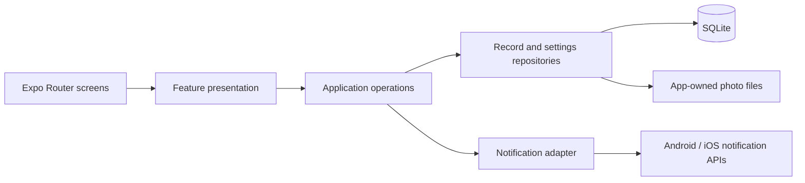

# Architecture Spine — DiaryClone

## Design Paradigm

Layered, feature-organized Expo app. Expo Router owns navigation; each feature's presentation layer renders and collects input; application operations own rules and mutations; data adapters own SQLite, app files, and OS APIs. A screen never calls a persistence or notification API directly. `DESIGN.md`, `EXPERIENCE.md`, and each selected capture bind the visible UI without becoming data owners.



## Invariants & Rules

### AD-1 — One mutation path [ADOPTED]

- **Binds:** FR-3–5, FR-8–13, FR-16–17.
- **Prevents:** Today, detail, history, and insights applying different rules to the same record.
- **Rule:** Presentation invokes application operations for draft, complete, and edit. Only the record repository writes completed reflections; all reading surfaces query that repository or pure projections of its rows. No screen-specific persistent copy or seeded example record.

### AD-2 — Stable record day and identity [ADOPTED]

- **Binds:** FR-3–5, FR-8–13, FR-17.
- **Prevents:** Duplicate daily completions and records moving between days or months after a time-zone change.
- **Rule:** A reflection starts as a session for one selected device-local calendar day and kind (`morning` or `evening`). Assign its stable `YYYY-MM-DD` `dayKey` when the session starts; drafts, completion, and later edits keep that key even across midnight or a time-zone change. Enforce uniqueness of completed reflections on `(dayKey, kind)` in SQLite. Daily lists, Trends period aggregation, mood history, and streaks use that key. Today opens the current day's sessions.

### AD-3 — Draft and commit are distinct [ADOPTED]

- **Binds:** FR-4–5, FR-10, FR-16–17.
- **Prevents:** An interrupted entry counting as complete or a failed save erasing an existing record.
- **Rule:** Persist all in-progress answers, selections, slider values, optional photo reference, and resume step in drafts keyed by session day and kind; flush changed fields before leaving a step, closing, or backgrounding. The Router can reopen a stored draft by day and kind after Today advances to another date. Drafts are absent from history, streaks, and insights. Completion and detail edits enforce the same limits: at most three morning focus choices, at least one evening feeling, and a persisted evening bedtime response (`Yes`, `No`, or `Skip & Finish`). Serialize writes and commit a completed reflection plus draft removal, or an edit, in an exclusive SQLite transaction. On failure retain the draft or prior completed row and surface retry.

### AD-4 — Photo bytes and references agree

- **Binds:** FR-5, FR-10, FR-16.
- **Prevents:** Temporary picker URIs breaking after restart or a record referencing a missing photo.
- **Rule:** Copy a selected image into app-owned persistent files before recording its draft or completed reference; store an app-relative photo key, never a temporary picker URI or device-absolute path. If copying fails, retain answers and transient selection on screen, offer retry or reselect after restart, and complete without the photo only if the user removes it. A copied replacement is a staged file until the database commit succeeds. On commit failure, keep that stage for retry while the old reference and file stay intact; clean abandoned stages on cancel or recovery. After commit, clean the old file. On OS restore, a missing photo file yields a missing-media state without deleting its reflection. Photos are optional attachments of authored evening reflections, never independent entries.

### AD-5 — Derived views never own facts

- **Binds:** FR-8–13, FR-17.
- **Prevents:** Journey cards, mood calendar, trends, and streaks disagreeing after an edit.
- **Rule:** Compute these views from committed reflection rows using shared selectors or queries. Store evening feelings as a set of selected values. One shared `moodDayProjection` owns the date-level representation consumed by Mood calendar and Trends; without an approved mapping from multiple feelings to a single mark, expose the set or an unavailable mark, never an invented score. A successful mutation invalidates every dependent query; a failed one invalidates none. Missing data produces an empty or insufficient-data state, never invented values. Period changes update chart labels, axes, marks, cards, and pager from the same selected period.

### AD-6 — Reminder intent and effective state differ [ADOPTED]

- **Binds:** FR-15.
- **Prevents:** A switch claiming a reminder is on when OS permission or scheduling has failed.
- **Rule:** Support only morning and evening recurring daily local reminders. Settings own each reminder's user-selected local hour/minute and intent; onboarding and Profile edit the same values through the native time picker. A canceled picker leaves them unchanged. The notification adapter owns one authoritative OS schedule ID per reminder and reports effective state. For an enabled time change, create the replacement schedule, persist the new time and ID, then cancel the old schedule; on any failure restore the old effective setting and clean the replacement, and reconcile stray schedules on the next launch. The user requires minute-level timing, so Android internal builds declare `SCHEDULE_EXACT_ALARM`; enabling checks notification permission and Android exact-alarm access, requests missing access, then uses `alarmClock` delivery with its visible status-bar alarm icon. Persist enabled state only after scheduling succeeds. Denial or failure leaves the effective switch off. Turning off cancels its schedule. On launch/foreground, if intent is enabled, permission remains granted, and the OS schedule is missing, recreate that one daily schedule; if permission was revoked, clear effective state and require a user switch-on after restoration. Never register remote push tokens.

### AD-7 — Device-owned runtime data [ADOPTED]

- **Binds:** FR-4–5, FR-8–17.
- **Prevents:** Separate features quietly adding accounts, runtime sync, or telemetry carrying diary content.
- **Rule:** The app has no runtime backend, account, cloud sync, or journal-content upload. SQLite and photo files stay in the app container. OS-default device backup is permitted; it is separate from app-managed sync. Never log reflection text, moods, or photo paths to a remote service.

### AD-8 — Schema changes preserve saved entries

- **Binds:** FR-16 and all future features that change persisted records.
- **Prevents:** A new build losing or silently reinterpreting prior local records.
- **Rule:** Version SQLite schema and run ordered migrations before reading app data. A migration failure blocks writes and shows a recoverable error; it must not recreate an empty database over existing data. Keep derived insights rebuildable from reflection rows.

### AD-9 — Preferences own first-run transitions

- **Binds:** FR-1, FR-15, FR-17.
- **Prevents:** Onboarding, reminder settings, and streak controls showing contradictory first-run states.
- **Rule:** One local settings repository owns onboarding answers and completion, reminder preferences, streak visibility/goal, and a flag that the streak-choice flow was shown. Router starts at onboarding until its completion flag commits, then opens Today on later launches; notification denial cannot block onboarding. The first successful reflection completion triggers the streak-choice flow once. Streak length remains derived from completed reflection days, not a stored counter.

### AD-10 — Date-dependent screens refresh together

- **Binds:** FR-3, FR-6, FR-11, FR-17.
- **Prevents:** Today, Tomorrow, and the current Trends period disagreeing when the app stays open across midnight.
- **Rule:** A shared clock/date boundary invalidates Today status, Tomorrow countdown, and date-derived views at local midnight and on foreground return or device time/time-zone change. Past completed records retain their stored `dayKey`.

## Consistency Conventions

| Concern | Convention |
| --- | --- |
| Keys | Reflection: stable opaque ID; `dayKey`: device-local `YYYY-MM-DD` assigned to the session at start; kind: `morning` or `evening`. UTC timestamps may record ordering but never reassign `dayKey`. |
| Ownership | `reflections` owns committed answers, moods, and photo references; `drafts` owns incomplete answers; `settings` owns onboarding, streak, reminder times and intent; the notification adapter owns OS schedule IDs; insights own no stored facts. |
| Read changes | Repository commit is the only success boundary. Refresh Today, Journey, daily entries, mood calendar, Trends periods, and streaks after that boundary. |
| Error handling | Preserve prior committed data and visible unsaved input; report local storage/file/permission failure with retry or Settings path. |
| Scope | The UX spine governs routes and behavior; the design spine and selected captures govern appearance. Keep only the two scoped reminder rows; source `During the Day` and `Your Daily Focus` are reference-only. |
| Navigation | Bottom destinations are Today and Journey. Profile is a nested sheet over Today; Tomorrow opens from Today; Entry detail returns to its originating list. Router preserves selected date/period and parent scroll context on Back. |
| Platform UI | English copy, shared Android/iOS app-screen design, SVG retained art, and 393 × 852 iOS capture comparison. Native permission/time-picker UI, safe areas, keyboard avoidance, reflow, screen-reader state, chart text alternatives, and reduced motion follow the UX spine. |

## Stack

| Name | Version |
| --- | --- |
| [Expo default starter](https://docs.expo.dev/get-started/create-a-project/) | SDK 58 (`default@sdk-58`) |
| [React Native](https://docs.expo.dev/versions/v58.0.0/) | 0.88 |
| [Expo Router](https://docs.expo.dev/versions/v58.0.0/sdk/router/) | ~58.0.25 |
| [expo-sqlite](https://docs.expo.dev/versions/v58.0.0/sdk/sqlite/) | ~58.0.13 |
| [expo-file-system](https://docs.expo.dev/versions/v58.0.0/sdk/filesystem/) | ~58.0.10 |
| [expo-image-picker](https://docs.expo.dev/versions/v58.0.0/sdk/imagepicker/) | ~58.0.10 |
| [expo-notifications](https://docs.expo.dev/versions/v58.0.0/sdk/notifications/) | ~58.1.6 |

The generated app lockfile pins exact installed packages; install SDK-matched modules with `expo install`.

## Structural Seed

```text
src/app/             # Expo Router entry points and navigation only
src/features/        # Onboarding, Today, reflections, Journey, insights, Profile UI and operations
src/data/            # SQLite schema, migrations, repositories, projections, photo files
src/platform/        # Notification permission/scheduling and OS adapters
src/design/          # Shared tokens and components from DESIGN.md
assets/              # Local quotes, policy text, fonts, SVG assets
```

No runtime service or production database is deployed. Development builds and Android APK/iOS ad hoc internal builds use EAS Build; production screens read only device data. iOS physical-device distribution requires Apple signing and registered test devices. Test both OS permission states and scheduled delivery on devices; a simulator cannot establish reminder timing. Android exact-alarm denial keeps the reminder off rather than silently switching to approximate delivery. OS policies may still suppress visible notifications when the user disables notifications. OS-default backup is allowed but is not a restore guarantee: Android cloud Auto Backup has a 25 MB per-app limit, so photos may make a backup unavailable; restored photo keys must be checked against actual files.

For each selected flow, verify route/action reachability and no dead control on both operating systems. Compare retained screens against their selected captures on a 393 × 852 iOS baseline and on real device sizes.

## Capability → Architecture Map

| Capability / Area | Lives in | Governed by |
| --- | --- | --- |
| FR-1–3, FR-6–7, FR-14 | Router, onboarding/Today/Profile features, packaged content | AD-9–10, UX/design spines |
| FR-4–5, FR-10, FR-16 | Reflection operations, repository, photo files | AD-1–4, AD-7–8 |
| FR-8–9, FR-11–13 | History and insight projections over reflections | AD-1–2, AD-5 |
| FR-15 | Reminder operations and notification adapter | AD-6 |
| FR-17 | Settings and streak projection over completed days | AD-2, AD-5, AD-9 |
| FR-2 | Router entries for included destinations only | Paradigm, UX spine |

## Deferred

- Draft write debounce and prior-day draft entry affordance, and quote rotation remain implementation details within the durable-save and local-content rules above. The owner resolved Entry detail editing (`More → Edit`, `Save`/`Cancel`), the three eligible Trends count types, and captured Privacy/reminder copy for internal screen reproduction. Quotes and policy text are packaged read-only content; missing content gets an unavailable state, not a dead control. The captured Privacy copy does not establish runtime capabilities or an external-release policy.
- App-managed encryption and export/restore: reconsider before any external release or change in privacy requirements. Current phase accepts OS-default backup and has no app sync.
- Build account credentials, Apple device roster, and release channel names: fix at internal distribution setup; the EAS/cloud-build boundary is set.
- Public-store release of exact Android alarms: reassess `alarmClock`, its persistent status-bar icon, and store policy for this diary reminder before distributing beyond internal builds.
- The current PRD FR-1–17 and companion UX spines are the authority for the v6 epic plan.
