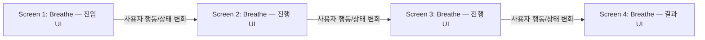
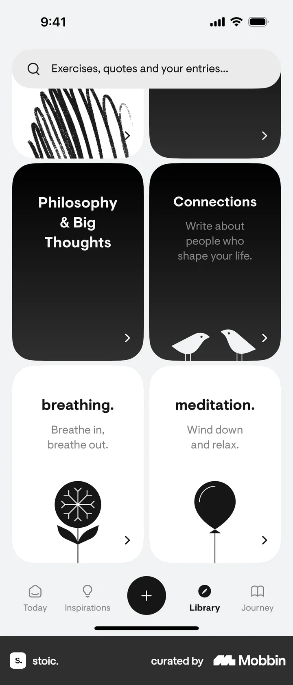
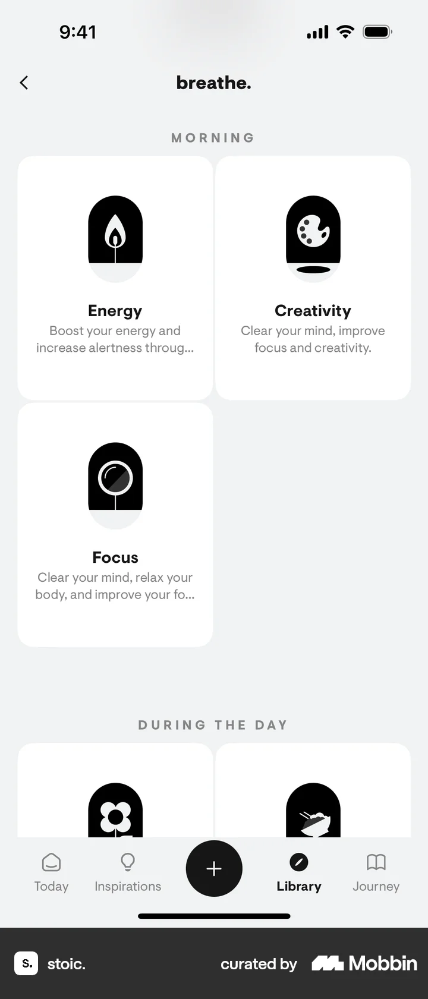
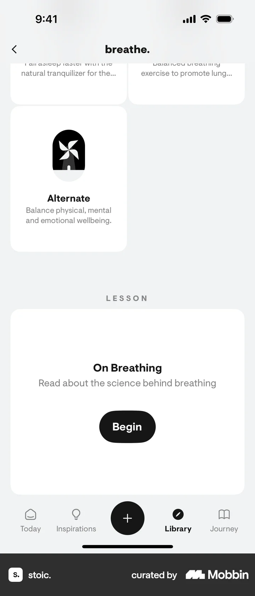

# Breathe

- 상태: **verified**
- Mobbin 상세 페이지: [https://mobbin.com/flows/a4a51054-0a2b-4d99-aa45-c76f08de53a0](https://mobbin.com/flows/a4a51054-0a2b-4d99-aa45-c76f08de53a0)
- 앱: stoic.
- 기기: iOS (393x852)
- 화면 수: 4
- 저장한 이미지 수: 4
- 검증: 상세 페이지 제목·URL, 이미지 출처, 화면 수/파일 수, Mermaid 순서를 확인함. 

## Mermaid flow

## 화면별 관찰

### 1. 화면 1

진입 상태: Breathe 플로우의 첫 iOS 화면. 화면에 보이는 시작 UI와 현재 선택 상태는 첨부 이미지에서 확인된다.

### 2. 화면 2

진행 상태: Breathe을 수행하는 중간 단계. 이전 화면의 선택 또는 입력 뒤 다음 UI가 열리고, 현재 표시된 제어 요소와 값은 첨부 이미지에서 확인된다.

### 3. 화면 3

진행 상태: Breathe을 수행하는 중간 단계. 이전 화면의 선택 또는 입력 뒤 다음 UI가 열리고, 현재 표시된 제어 요소와 값은 첨부 이미지에서 확인된다.

### 4. 화면 4

결과 상태: Breathe에 해당하는 마지막 iOS 화면. 사용자가 Breathe을 수행한 뒤 보이는 결과 UI가 첨부 이미지에 표시된다.

## BMad handoff notes

- 진입 상태: Breathe from Library의 Mobbin 상세 페이지에서 iOS Screens 뷰를 열고 첫 화면부터 확인한다.
- 주요 행동: `Breathe`과 관련된 선택·입력·탭·재생·필터·정렬·설정 변경은 각 첨부 화면에 보이는 UI 기준으로 해석한다. 화면에서 확인할 수 없는 전제조건과 내부 처리 결과는 추정하지 않는다.
- 기대 결과: 마지막 화면에서 `Breathe` 이후의 UI 상태가 표시된다. 정확한 서버 저장 여부나 계정 상태는 화면에서 확인 불가하다.
- 파괴적/되돌릴 수 없는 동작: 이 플로우의 스크린샷에서 삭제·계정 탈퇴·결제 확정 등 파괴적 동작은 확인 불가하다. 해당 동작이 실제 제품에서 존재하는지는 추정하지 않는다.
