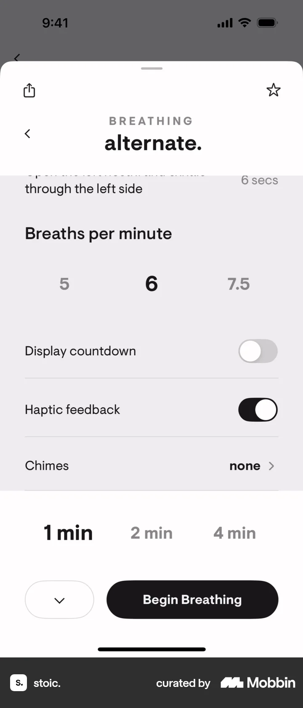
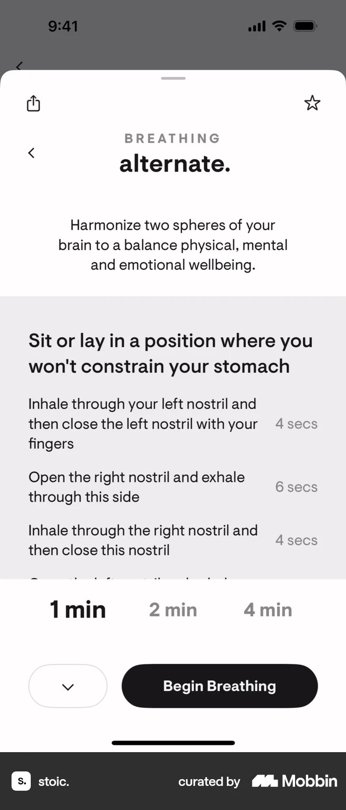
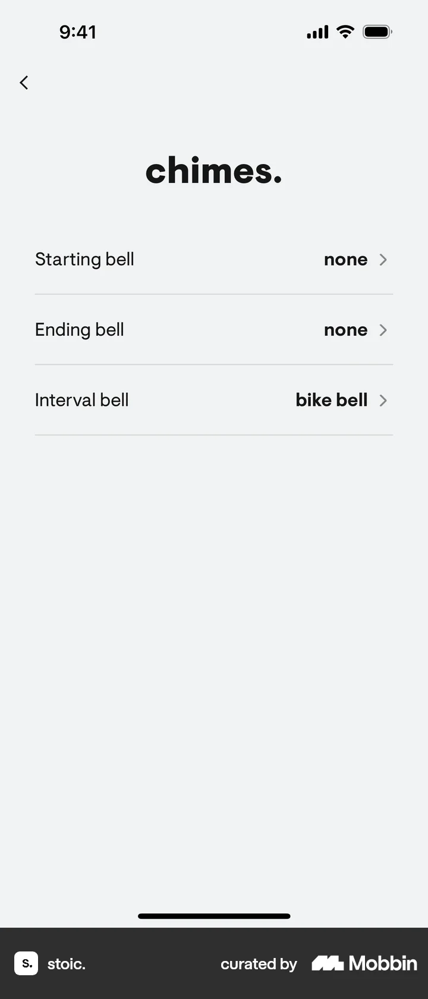
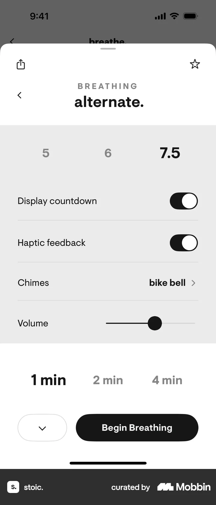

# Setting up exercise preferences

- 상태: **verified**
- Mobbin 상세 페이지: [https://mobbin.com/flows/fc324f7f-bf3c-48a2-9c3e-b41d8639e11e](https://mobbin.com/flows/fc324f7f-bf3c-48a2-9c3e-b41d8639e11e)
- 앱: stoic.
- 기기: iOS (393x852)
- 화면 수: 9
- 저장한 이미지 수: 9
- 검증: 상세 페이지 제목·URL, 이미지 출처, 화면 수/파일 수, Mermaid 순서를 확인함. 

## Mermaid flow

```mermaid
flowchart LR
    S1["Screen 1: Setting up exercise preferences — 진입 UI"]
    S2["Screen 2: Setting up exercise preferences — 진행 UI"]
    S3["Screen 3: Setting up exercise preferences — 진행 UI"]
    S4["Screen 4: Setting up exercise preferences — 진행 UI"]
    S5["Screen 5: Setting up exercise preferences — 진행 UI"]
    S6["Screen 6: Setting up exercise preferences — 진행 UI"]
    S7["Screen 7: Setting up exercise preferences — 진행 UI"]
    S8["Screen 8: Setting up exercise preferences — 진행 UI"]
    S9["Screen 9: Setting up exercise preferences — 결과 UI"]
    S1 -->|사용자 행동/상태 변화| S2
    S2 -->|사용자 행동/상태 변화| S3
    S3 -->|사용자 행동/상태 변화| S4
    S4 -->|사용자 행동/상태 변화| S5
    S5 -->|사용자 행동/상태 변화| S6
    S6 -->|사용자 행동/상태 변화| S7
    S7 -->|사용자 행동/상태 변화| S8
    S8 -->|사용자 행동/상태 변화| S9
```

## 화면별 관찰

### 1. 화면 1

진입 상태: Setting up exercise preferences 플로우의 첫 iOS 화면. 화면에 보이는 시작 UI와 현재 선택 상태는 첨부 이미지에서 확인된다.

### 2. 화면 2

진행 상태: Setting up exercise preferences을 수행하는 중간 단계. 이전 화면의 선택 또는 입력 뒤 다음 UI가 열리고, 현재 표시된 제어 요소와 값은 첨부 이미지에서 확인된다.

### 3. 화면 3

진행 상태: Setting up exercise preferences을 수행하는 중간 단계. 이전 화면의 선택 또는 입력 뒤 다음 UI가 열리고, 현재 표시된 제어 요소와 값은 첨부 이미지에서 확인된다.

### 4. 화면 4

진행 상태: Setting up exercise preferences을 수행하는 중간 단계. 이전 화면의 선택 또는 입력 뒤 다음 UI가 열리고, 현재 표시된 제어 요소와 값은 첨부 이미지에서 확인된다.

### 5. 화면 5

진행 상태: Setting up exercise preferences을 수행하는 중간 단계. 이전 화면의 선택 또는 입력 뒤 다음 UI가 열리고, 현재 표시된 제어 요소와 값은 첨부 이미지에서 확인된다.

### 6. 화면 6

진행 상태: Setting up exercise preferences을 수행하는 중간 단계. 이전 화면의 선택 또는 입력 뒤 다음 UI가 열리고, 현재 표시된 제어 요소와 값은 첨부 이미지에서 확인된다.

### 7. 화면 7

진행 상태: Setting up exercise preferences을 수행하는 중간 단계. 이전 화면의 선택 또는 입력 뒤 다음 UI가 열리고, 현재 표시된 제어 요소와 값은 첨부 이미지에서 확인된다.

### 8. 화면 8

진행 상태: Setting up exercise preferences을 수행하는 중간 단계. 이전 화면의 선택 또는 입력 뒤 다음 UI가 열리고, 현재 표시된 제어 요소와 값은 첨부 이미지에서 확인된다.

### 9. 화면 9

결과 상태: Setting up exercise preferences에 해당하는 마지막 iOS 화면. 사용자가 Setting up exercise preferences을 수행한 뒤 보이는 결과 UI가 첨부 이미지에 표시된다.

## BMad handoff notes

- 진입 상태: Setting up exercise preferences from Completing an exercise (breathing)의 Mobbin 상세 페이지에서 iOS Screens 뷰를 열고 첫 화면부터 확인한다.
- 주요 행동: `Setting up exercise preferences`과 관련된 선택·입력·탭·재생·필터·정렬·설정 변경은 각 첨부 화면에 보이는 UI 기준으로 해석한다. 화면에서 확인할 수 없는 전제조건과 내부 처리 결과는 추정하지 않는다.
- 기대 결과: 마지막 화면에서 `Setting up exercise preferences` 이후의 UI 상태가 표시된다. 정확한 서버 저장 여부나 계정 상태는 화면에서 확인 불가하다.
- 파괴적/되돌릴 수 없는 동작: 이 플로우의 스크린샷에서 삭제·계정 탈퇴·결제 확정 등 파괴적 동작은 확인 불가하다. 해당 동작이 실제 제품에서 존재하는지는 추정하지 않는다.
